# MMSS Principle Synthesis

<p align="center"></p>

Evidence-aware architecture synthesis for AI agents.

Create, audit, repair, extend, and transfer modular MMSS architectures from sources, requirements, or existing stacks.

[English](README.md) · [Русский](README.ru.md)

    [](https://github.com/Abstract-Mindfreak/mmss-principle-synthesis/actions/workflows/validate.yml)

## Overview

MMSS Principle Synthesis is an Agent Skill: an instruction file that helps an AI agent perform structured architecture work. When expanded explicitly, MMSS means **Meta-Meta-Synthesizer Systems**; where no expansion is given, the acronym remains open to interpretation in context.

## Capabilities

- Synthesize from source material, explicit requirements, or a supplied stack.
- Audit, validate, repair, extend, and transfer modular architectures.
- Keep evidence, inferences, requirements, assumptions, and checks distinguishable.
- Return structured JSON by default, while following an explicit output contract.

## Skill editions

| Edition icon | Skill package | Version | Role |
| --- | --- | --- | --- |
|  | [`mmss-principle-synthesis`](skills/mmss-principle-synthesis/SKILL.md) | **0.3.0 · primary** | Recommended starting skill; core instructions use two companion reference files. |
|  | [`mmss-principle-synthesis-monolithic`](skills/mmss-principle-synthesis-monolithic/SKILL.md) | **0.1.5 · retained snapshot** | Earlier complete single-file edition, kept separately for users who need that content. |

Start with the **composite v0.3.0 edition**. It is the repository's primary, recommended entry skill and has two required companion files:

| File | Purpose | Raw |
| --- | --- | --- |
| [`SKILL.md`](skills/mmss-principle-synthesis/SKILL.md) | Core instructions and the skill's entry point | [Open raw](https://raw.githubusercontent.com/Abstract-Mindfreak/mmss-principle-synthesis/main/skills/mmss-principle-synthesis/SKILL.md) |
| [`DISPATCH.md`](skills/mmss-principle-synthesis/DISPATCH.md) | Index of IDs and markers for finding relevant reference sections | [Open raw](https://raw.githubusercontent.com/Abstract-Mindfreak/mmss-principle-synthesis/main/skills/mmss-principle-synthesis/DISPATCH.md) |
| [`ALL_REFERENCES.md`](skills/mmss-principle-synthesis/ALL_REFERENCES.md) | Full body of reference sections used by the instructions | [Open raw](https://raw.githubusercontent.com/Abstract-Mindfreak/mmss-principle-synthesis/main/skills/mmss-principle-synthesis/ALL_REFERENCES.md) |

`SKILL.md` is the starting instruction; `DISPATCH.md` helps the agent select material from `ALL_REFERENCES.md`. A chat needs all three files available. `DISPATCH.md` is a documentation index, not an executable loader.

**Monolithic v0.1.5** (`mmss-principle-synthesis-monolithic`) is a retained single-file snapshot of the earlier edition. Choose it when one complete file or that historical content is specifically needed: [README](docs/skills/mmss-principle-synthesis-monolithic/README.md) · [SKILL.md](skills/mmss-principle-synthesis-monolithic/SKILL.md) · [raw SKILL.md](https://raw.githubusercontent.com/Abstract-Mindfreak/mmss-principle-synthesis/main/skills/mmss-principle-synthesis-monolithic/SKILL.md).

The version numbers belong to two different skill IDs, not synchronized builds of one package. The 0.3.0 and 0.1.5 versions are therefore intentionally different. The monolithic copy preserves the v0.1.5 text; only its frontmatter name changed so both packages can be discovered separately.

## Related skills

Twenty-six related skill packages are available as independent siblings under [`skills/`](skills/).

| Icon | Skill | Role | Raw SKILL.md |
| --- | --- | --- | --- |
|  | [`action-sufficient-latent-compression`](docs/skills/action-sufficient-latent-compression/README.md) | Compresses long tool observations while preserving action-relevant information. | [Raw](https://raw.githubusercontent.com/Abstract-Mindfreak/mmss-principle-synthesis/main/skills/action-sufficient-latent-compression/SKILL.md) |
|  | [`adaptive-commercial-specializer`](docs/skills/adaptive-commercial-specializer/README.md) | Builds practical commercial specializations from available material and constraints. | [Raw](https://raw.githubusercontent.com/Abstract-Mindfreak/mmss-principle-synthesis/main/skills/adaptive-commercial-specializer/SKILL.md) |
|  | [`adaptive-open-skill-synthesizer`](docs/skills/adaptive-open-skill-synthesizer/README.md) | Creates or reshapes skills around open variables and discovered methods. | [Raw](https://raw.githubusercontent.com/Abstract-Mindfreak/mmss-principle-synthesis/main/skills/adaptive-open-skill-synthesizer/SKILL.md) |
|  | [`adaptive-ux-correction-invariant`](docs/skills/adaptive-ux-correction-invariant/README.md) | Diagnoses interfaces and proposes minimal UX corrections from stable invariants. | [Raw](https://raw.githubusercontent.com/Abstract-Mindfreak/mmss-principle-synthesis/main/skills/adaptive-ux-correction-invariant/SKILL.md) |
|  | [`adaptive-ux-orchestrator`](docs/skills/adaptive-ux-orchestrator/README.md) | Coordinates the UX laws and correction skills in a staged workflow. | [Raw](https://raw.githubusercontent.com/Abstract-Mindfreak/mmss-principle-synthesis/main/skills/adaptive-ux-orchestrator/SKILL.md) |
|  | [`animated-svg-icon-composer`](docs/skills/animated-svg-icon-composer/README.md) | Creates self-contained animated SVG icons from semantic descriptions. | [Raw](https://raw.githubusercontent.com/Abstract-Mindfreak/mmss-principle-synthesis/main/skills/animated-svg-icon-composer/SKILL.md) |
|  | [`automatic-creativity-flow`](docs/skills/automatic-creativity-flow/README.md) | Creates artifacts through material generation, perspective shifts, and local interventions. | [Raw](https://raw.githubusercontent.com/Abstract-Mindfreak/mmss-principle-synthesis/main/skills/automatic-creativity-flow/SKILL.md) |
|  | [`data-to-skill`](docs/skills/data-to-skill/README.md) | Transforms inspectable source material into skills with selectable synthesis operations. | [Raw](https://raw.githubusercontent.com/Abstract-Mindfreak/mmss-principle-synthesis/main/skills/data-to-skill/SKILL.md) |
|  | [`data-to-skill-transformer`](docs/skills/data-to-skill-transformer/README.md) | Uses a prescriptive seven-step transformation and emits a SKILL.md artifact by default. | [Raw](https://raw.githubusercontent.com/Abstract-Mindfreak/mmss-principle-synthesis/main/skills/data-to-skill-transformer/SKILL.md) |
|  | [`meta-hypergraph-ontology-alchemy`](docs/skills/meta-hypergraph-ontology-alchemy/README.md) | Explores ontology alternatives and mirrored meta-level structures. | [Raw](https://raw.githubusercontent.com/Abstract-Mindfreak/mmss-principle-synthesis/main/skills/meta-hypergraph-ontology-alchemy/SKILL.md) |
|  | [`mmss-adaptive-sp-combinator`](docs/skills/mmss-adaptive-sp-combinator/README.md) | Explores and combines skills, systems, properties, and combination methods while preserving MMSS contracts. | [Raw](https://raw.githubusercontent.com/Abstract-Mindfreak/mmss-principle-synthesis/main/skills/mmss-adaptive-sp-combinator/SKILL.md) |
|  | [`mmss-adaptive-ux-laws-application`](docs/skills/mmss-adaptive-ux-laws-application/README.md) | Applies Laws of UX sequentially to find issues and propose measurable changes. | [Raw](https://raw.githubusercontent.com/Abstract-Mindfreak/mmss-principle-synthesis/main/skills/mmss-adaptive-ux-laws-application/SKILL.md) |
|  | [`mmss-domain-specialist-synthesizer`](docs/skills/mmss-domain-specialist-synthesizer/README.md) | Builds self-contained MMSS-compatible domain specialist skills. | [Raw](https://raw.githubusercontent.com/Abstract-Mindfreak/mmss-principle-synthesis/main/skills/mmss-domain-specialist-synthesizer/SKILL.md) |
|  | [`mmss-integrated-kernel`](docs/skills/mmss-integrated-kernel/README.md) | Combines MMSS architecture, session compaction, and evidence-aware research mechanisms. | [Raw](https://raw.githubusercontent.com/Abstract-Mindfreak/mmss-principle-synthesis/main/skills/mmss-integrated-kernel/SKILL.md) |
|  | [`mmss-jepa-platonic-meta-unifier`](docs/skills/mmss-jepa-platonic-meta-unifier/README.md) | Unifies robust JEPA–Platonic invariants across MMSS and related architectures. | [Raw](https://raw.githubusercontent.com/Abstract-Mindfreak/mmss-principle-synthesis/main/skills/mmss-jepa-platonic-meta-unifier/SKILL.md) |
|  | [`mmss-schema-guided-agent-bridge`](docs/skills/mmss-schema-guided-agent-bridge/README.md) | Connects schemas, routing, and agent architectures. | [Raw](https://raw.githubusercontent.com/Abstract-Mindfreak/mmss-principle-synthesis/main/skills/mmss-schema-guided-agent-bridge/SKILL.md) |
|  | [`mmss-skill-boundary-combinator`](docs/skills/mmss-skill-boundary-combinator/README.md) | Combines skills while tracking boundaries and MMSS invariants. | [Raw](https://raw.githubusercontent.com/Abstract-Mindfreak/mmss-principle-synthesis/main/skills/mmss-skill-boundary-combinator/SKILL.md) |
|  | [`mmss-skill-router`](docs/skills/mmss-skill-router/README.md) | Routes MMSS-specific work to suitable skills. | [Raw](https://raw.githubusercontent.com/Abstract-Mindfreak/mmss-principle-synthesis/main/skills/mmss-skill-router/SKILL.md) |
|  | [`mmss-mta-delta-architect`](docs/skills/mmss-mta-delta-architect/README.md) | Builds and evolves Meta-Textual Architectures for MMSS. | [Raw](https://raw.githubusercontent.com/Abstract-Mindfreak/mmss-principle-synthesis/main/skills/mmss-mta-delta-architect/SKILL.md) |
|  | [`quantum-hyperloop-research-agent`](docs/skills/quantum-hyperloop-research-agent/README.md) | Plans and performs adaptive, evidence-aware research. | [Raw](https://raw.githubusercontent.com/Abstract-Mindfreak/mmss-principle-synthesis/main/skills/quantum-hyperloop-research-agent/SKILL.md) |
|  | [`quantum-meta-architect`](docs/skills/quantum-meta-architect/README.md) | Performs bounded meta-analysis of tasks, architectures, and research methods. | [Raw](https://raw.githubusercontent.com/Abstract-Mindfreak/mmss-principle-synthesis/main/skills/quantum-meta-architect/SKILL.md) |
|  | [`mmss-reopen-the-problem`](docs/skills/mmss-reopen-the-problem/README.md) | Reframes familiar problems by separating intent and constraints from inherited forms. | [Raw](https://raw.githubusercontent.com/Abstract-Mindfreak/mmss-principle-synthesis/main/skills/mmss-reopen-the-problem/SKILL.md) |
|  | [`session-process-logger`](docs/skills/session-process-logger/README.md) | Creates traceable retrospective logs from session evidence. | [Raw](https://raw.githubusercontent.com/Abstract-Mindfreak/mmss-principle-synthesis/main/skills/session-process-logger/SKILL.md) |
|  | [`session-to-skill`](docs/skills/session-to-skill/README.md) | Derives a reusable skill from session material. | [Raw](https://raw.githubusercontent.com/Abstract-Mindfreak/mmss-principle-synthesis/main/skills/session-to-skill/SKILL.md) |
|  | [`skill-quick-sampler`](docs/skills/skill-quick-sampler/README.md) | Samples skill catalogues and emits short usage examples. | [Raw](https://raw.githubusercontent.com/Abstract-Mindfreak/mmss-principle-synthesis/main/skills/skill-quick-sampler/SKILL.md) |
|  | [`mmss-symmetric-meta-hypergraph-synthesis`](docs/skills/mmss-symmetric-meta-hypergraph-synthesis/README.md) | Extracts and combines reusable patterns in symmetric meta-level structures. | [Raw](https://raw.githubusercontent.com/Abstract-Mindfreak/mmss-principle-synthesis/main/skills/mmss-symmetric-meta-hypergraph-synthesis/SKILL.md) |

## Quick start

Install the composite edition with the [Skills CLI](https://github.com/vercel-labs/skills):

```sh
npx skills add Abstract-Mindfreak/mmss-principle-synthesis --skill mmss-principle-synthesis
```

To list all skills directly from the remote repository without installing them:

```sh
npx skills add Abstract-Mindfreak/mmss-principle-synthesis --list
```

To list skills from an existing local checkout, run this from the repository root:

```sh
npx skills add . --list
```

The skill provides instructions only. Agent behavior, tools, persistence, and compatibility depend on the host agent.

## Usage examples

Ask an agent to design a module from requirements, audit an existing architecture, or synthesize a system from supplied sources. Small illustrative prompts and expected properties are in [examples](examples/README.md). They are not evaluation results.

## How it works

The skill inspects the supplied foundation, identifies the requested operation and artifact, preserves provenance and uncertainty, constructs only the needed architecture, and reports checks within their actual scope. See [design principles](docs/design-principles.md).

## Output and language behavior

Structured JSON is the default unless the user requests another format. Stable machine-readable identifiers are preserved while human-readable content follows the user's language instructions. The skill's own language policy remains defined in its `SKILL.md`.

## Compatibility

Each package uses the Agent Skills `SKILL.md` convention with YAML frontmatter. The Skills CLI supports repository discovery and skill selection. This repository has not verified installation on individual agent platforms; host-specific behavior can differ. Each skill has a separate documentation page with its own SVG icon, embedded with an HTML `` element; animated source files retain their animation.

## Validation and limitations

The local validator checks repository packaging, skill frontmatter, JSON fixtures, and local file links. GitHub Actions runs the same validator and `git diff --check`; these checks do not assess model outputs or architectural quality. See [evaluation notes](docs/evaluation.md) for the limits of one accompanied experiment.

## Repository structure

| Path | Purpose |
| --- | --- |
| `skills/mmss-principle-synthesis/` | Composite v0.3.0 package: `SKILL.md`, `ALL_REFERENCES.md`, and `DISPATCH.md` |
| `skills/mmss-principle-synthesis-monolithic/SKILL.md` | Monolithic v0.1.5 edition |
| `skills/<skill-name>/SKILL.md` and `docs/skills/<skill-name>/README.md` | Twenty-six standalone related skill packages |
| `examples/` | Synthetic prompts and expected properties |
| `docs/` | Design principles, evaluation scope, and individual skill READMEs |
| `docs/skills/<skill-name>/` | Individual README and matching SVG icon for each related skill |
| `docs/assets/mmss-icon.svg` | Repository-wide animated MMSS mark |
| `scripts/validate_repository.py` | Local packaging validator |
| `.github/workflows/validate.yml` | Read-only repository validation |

## Contributing

See [CONTRIBUTING.md](CONTRIBUTING.md) for reproducible reports, checks, and contribution terms.

## Project values

This project is created with the hope that it will help people learn, build useful tools, and share knowledge responsibly.

The author encourages peaceful, constructive uses that respect human dignity.

This statement expresses the author's values and does not add restrictions to the MIT License.

## Author

Created and maintained by Andrey Mundrievskiy, known online as Abstract-Mindfreak.

## License

Released under the [MIT License](LICENSE).
