# MMSS Principle Synthesis

<p align="center"></p>

Синтез архитектур с учётом источников и границ выводов для ИИ-агентов.

Создание, аудит, исправление, расширение и перенос модульных архитектур MMSS на основе источников, требований или существующих систем.

[English](README.md) · [Русский](README.ru.md)

    [](https://github.com/Abstract-Mindfreak/mmss-principle-synthesis/actions/workflows/validate.yml)

## Обзор

MMSS Principle Synthesis — это Agent Skill: файл инструкций для структурированной работы ИИ-агента с архитектурами. При явной расшифровке MMSS означает **Meta-Meta-Synthesizer Systems**; если расшифровка не указана, аббревиатура остаётся открытой для интерпретации в контексте.

## Возможности

- Синтез на основе исходных материалов, явных требований или предоставленного стека.
- Аудит, проверка, исправление, расширение и перенос модульных архитектур.
- Разграничение свидетельств, выводов, требований, предположений и проверок.
- Структурированный JSON по умолчанию с соблюдением явного формата ответа.

## Редакции скилла

| Иконка редакции | Пакет скилла | Версия | Назначение |
| --- | --- | --- | --- |
| &nbsp;&nbsp;&nbsp;&nbsp;&nbsp;&nbsp; | [`mmss-principle-synthesis`](skills/mmss-principle-synthesis/SKILL.md) | **0.3.0 · основной** | Рекомендуемый стартовый скилл; основные инструкции используют два справочных файла-компаньона. |
| &nbsp;&nbsp;&nbsp;&nbsp;&nbsp;&nbsp; | [`mmss-principle-synthesis-monolithic`](skills/mmss-principle-synthesis-monolithic/SKILL.md) | **0.1.5 · сохранённый снимок** | Предыдущая полная однофайловая редакция для тех, кому нужно именно это содержимое. |

Начинайте с **составной редакции v0.3.0** — это основной рекомендуемый стартовый скилл репозитория. У него есть два обязательных файла-компаньона:

| Файл | Назначение | Raw |
| --- | --- | --- |
| [`SKILL.md`](skills/mmss-principle-synthesis/SKILL.md) | Основные инструкции и точка входа скилла | [Открыть raw](https://raw.githubusercontent.com/Abstract-Mindfreak/mmss-principle-synthesis/main/skills/mmss-principle-synthesis/SKILL.md) |
| [`DISPATCH.md`](skills/mmss-principle-synthesis/DISPATCH.md) | Индекс ID и маркеров, по которому агент находит нужный раздел справочника | [Открыть raw](https://raw.githubusercontent.com/Abstract-Mindfreak/mmss-principle-synthesis/main/skills/mmss-principle-synthesis/DISPATCH.md) |
| [`ALL_REFERENCES.md`](skills/mmss-principle-synthesis/ALL_REFERENCES.md) | Полный корпус справочных разделов, на которые ссылаются инструкции | [Открыть raw](https://raw.githubusercontent.com/Abstract-Mindfreak/mmss-principle-synthesis/main/skills/mmss-principle-synthesis/ALL_REFERENCES.md) |

`SKILL.md` — стартовая инструкция; `DISPATCH.md` помогает выбрать нужный материал из `ALL_REFERENCES.md`. Чату должны быть доступны все три файла. `DISPATCH.md` — документационный индекс, а не исполняемый загрузчик.

**Монолитная v0.1.5** (`mmss-principle-synthesis-monolithic`) — сохранённый однофайловый снимок предыдущей редакции. Выбирайте её, если нужен один полный файл или именно это историческое содержимое: [README](docs/skills/mmss-principle-synthesis-monolithic/README.md) · [SKILL.md](skills/mmss-principle-synthesis-monolithic/SKILL.md) · [raw SKILL.md](https://raw.githubusercontent.com/Abstract-Mindfreak/mmss-principle-synthesis/main/skills/mmss-principle-synthesis-monolithic/SKILL.md).

Номера версий относятся к двум разным идентификаторам скилла, а не к синхронным сборкам одного пакета. Поэтому версии 0.3.0 и 0.1.5 намеренно различаются. Монолитная копия сохраняет текст v0.1.5; изменено только имя в frontmatter, чтобы пакеты обнаруживались отдельно.

## Связанные скиллы

Двадцать шесть связанных пакетов доступны как самостоятельные каталоги в [`skills/`](skills/).

| Иконка SVG | Скилл | Назначение | Raw SKILL.md |
| --- | --- | --- | --- |
| &nbsp;&nbsp;&nbsp;&nbsp;&nbsp;&nbsp; | [`mmss-reopen-the-problem`](docs/skills/mmss-reopen-the-problem/README.md) | Переформулирует задачу, отделяя намерение и ограничения от привычной формы. | <br>[Raw](https://raw.githubusercontent.com/Abstract-Mindfreak/mmss-principle-synthesis/main/skills/mmss-reopen-the-problem/SKILL.md)<br> |
| &nbsp;&nbsp;&nbsp;&nbsp;&nbsp;&nbsp; | [`mmss-skill-router`](docs/skills/mmss-skill-router/README.md) | Направляет задачи MMSS к подходящим скиллам. | <br>[Raw](https://raw.githubusercontent.com/Abstract-Mindfreak/mmss-principle-synthesis/main/skills/mmss-skill-router/SKILL.md)<br> |
| &nbsp;&nbsp;&nbsp;&nbsp;&nbsp;&nbsp; | [`mmss-integrated-kernel`](docs/skills/mmss-integrated-kernel/README.md) | Объединяет механизмы архитектуры MMSS, сжатия сессий и доказательного исследования. | <br>[Raw](https://raw.githubusercontent.com/Abstract-Mindfreak/mmss-principle-synthesis/main/skills/mmss-integrated-kernel/SKILL.md)<br> |
| &nbsp;&nbsp;&nbsp;&nbsp;&nbsp;&nbsp; | [`mmss-domain-specialist-synthesizer`](docs/skills/mmss-domain-specialist-synthesizer/README.md) | Создаёт самостоятельные предметные скиллы, совместимые с MMSS. | <br>[Raw](https://raw.githubusercontent.com/Abstract-Mindfreak/mmss-principle-synthesis/main/skills/mmss-domain-specialist-synthesizer/SKILL.md)<br> |
| &nbsp;&nbsp;&nbsp;&nbsp;&nbsp;&nbsp; | [`mmss-schema-guided-agent-bridge`](docs/skills/mmss-schema-guided-agent-bridge/README.md) | Связывает схемы, маршрутизацию и архитектуры агентов. | <br>[Raw](https://raw.githubusercontent.com/Abstract-Mindfreak/mmss-principle-synthesis/main/skills/mmss-schema-guided-agent-bridge/SKILL.md)<br> |
| &nbsp;&nbsp;&nbsp;&nbsp;&nbsp;&nbsp; | [`mmss-mta-delta-architect`](docs/skills/mmss-mta-delta-architect/README.md) | Создаёт и развивает Meta-Textual Architectures для MMSS. | <br>[Raw](https://raw.githubusercontent.com/Abstract-Mindfreak/mmss-principle-synthesis/main/skills/mmss-mta-delta-architect/SKILL.md)<br> |
| &nbsp;&nbsp;&nbsp;&nbsp;&nbsp;&nbsp; | [`mmss-adaptive-sp-combinator`](docs/skills/mmss-adaptive-sp-combinator/README.md) | Исследует и комбинирует скиллы, системы и свойства, сохраняя контракты MMSS. | <br>[Raw](https://raw.githubusercontent.com/Abstract-Mindfreak/mmss-principle-synthesis/main/skills/mmss-adaptive-sp-combinator/SKILL.md)<br> |
| &nbsp;&nbsp;&nbsp;&nbsp;&nbsp;&nbsp; | [`mmss-skill-boundary-combinator`](docs/skills/mmss-skill-boundary-combinator/README.md) | Комбинирует скиллы с учётом границ и инвариантов MMSS. | <br>[Raw](https://raw.githubusercontent.com/Abstract-Mindfreak/mmss-principle-synthesis/main/skills/mmss-skill-boundary-combinator/SKILL.md)<br> |
| &nbsp;&nbsp;&nbsp;&nbsp;&nbsp;&nbsp; | [`mmss-symmetric-meta-hypergraph-synthesis`](docs/skills/mmss-symmetric-meta-hypergraph-synthesis/README.md) | Извлекает и комбинирует шаблоны симметричных метауровней. | <br>[Raw](https://raw.githubusercontent.com/Abstract-Mindfreak/mmss-principle-synthesis/main/skills/mmss-symmetric-meta-hypergraph-synthesis/SKILL.md)<br> |
| &nbsp;&nbsp;&nbsp;&nbsp;&nbsp;&nbsp; | [`mmss-jepa-platonic-meta-unifier`](docs/skills/mmss-jepa-platonic-meta-unifier/README.md) | Объединяет инварианты JEPA–Platonic в MMSS и родственных архитектурах. | <br>[Raw](https://raw.githubusercontent.com/Abstract-Mindfreak/mmss-principle-synthesis/main/skills/mmss-jepa-platonic-meta-unifier/SKILL.md)<br> |
| &nbsp;&nbsp;&nbsp;&nbsp;&nbsp;&nbsp; | [`mmss-adaptive-ux-laws-application`](docs/skills/mmss-adaptive-ux-laws-application/README.md) | Последовательно применяет Laws of UX для поиска проблем и измеримых предложений. | <br>[Raw](https://raw.githubusercontent.com/Abstract-Mindfreak/mmss-principle-synthesis/main/skills/mmss-adaptive-ux-laws-application/SKILL.md)<br> |
| &nbsp;&nbsp;&nbsp;&nbsp;&nbsp;&nbsp; | [`adaptive-ux-orchestrator`](docs/skills/adaptive-ux-orchestrator/README.md) | Координирует последовательную работу с законами UX и исправлениями. | <br>[Raw](https://raw.githubusercontent.com/Abstract-Mindfreak/mmss-principle-synthesis/main/skills/adaptive-ux-orchestrator/SKILL.md)<br> |
| &nbsp;&nbsp;&nbsp;&nbsp;&nbsp;&nbsp; | [`adaptive-ux-correction-invariant`](docs/skills/adaptive-ux-correction-invariant/README.md) | Диагностирует интерфейсы и предлагает минимальные UX-исправления по устойчивым инвариантам. | <br>[Raw](https://raw.githubusercontent.com/Abstract-Mindfreak/mmss-principle-synthesis/main/skills/adaptive-ux-correction-invariant/SKILL.md)<br> |
| &nbsp;&nbsp;&nbsp;&nbsp;&nbsp;&nbsp; | [`quantum-meta-architect`](docs/skills/quantum-meta-architect/README.md) | Выполняет ограниченный метаанализ задач, архитектур и методов исследования. | <br>[Raw](https://raw.githubusercontent.com/Abstract-Mindfreak/mmss-principle-synthesis/main/skills/quantum-meta-architect/SKILL.md)<br> |
| &nbsp;&nbsp;&nbsp;&nbsp;&nbsp;&nbsp; | [`quantum-hyperloop-research-agent`](docs/skills/quantum-hyperloop-research-agent/README.md) | Планирует и выполняет адаптивное исследование с учётом свидетельств. | <br>[Raw](https://raw.githubusercontent.com/Abstract-Mindfreak/mmss-principle-synthesis/main/skills/quantum-hyperloop-research-agent/SKILL.md)<br> |
| &nbsp;&nbsp;&nbsp;&nbsp;&nbsp;&nbsp; | [`adaptive-commercial-specializer`](docs/skills/adaptive-commercial-specializer/README.md) | Создаёт практические коммерческие специализации из материалов и ограничений. | <br>[Raw](https://raw.githubusercontent.com/Abstract-Mindfreak/mmss-principle-synthesis/main/skills/adaptive-commercial-specializer/SKILL.md)<br> |
| &nbsp;&nbsp;&nbsp;&nbsp;&nbsp;&nbsp; | [`data-to-skill`](docs/skills/data-to-skill/README.md) | Преобразует исходные материалы в скиллы с выбираемыми операциями синтеза. | <br>[Raw](https://raw.githubusercontent.com/Abstract-Mindfreak/mmss-principle-synthesis/main/skills/data-to-skill/SKILL.md)<br> |
| &nbsp;&nbsp;&nbsp;&nbsp;&nbsp;&nbsp; | [`data-to-skill-transformer`](docs/skills/data-to-skill-transformer/README.md) | Применяет предписанный процесс из семи шагов и по умолчанию создаёт SKILL.md. | <br>[Raw](https://raw.githubusercontent.com/Abstract-Mindfreak/mmss-principle-synthesis/main/skills/data-to-skill-transformer/SKILL.md)<br> |
| &nbsp;&nbsp;&nbsp;&nbsp;&nbsp;&nbsp; | [`session-process-logger`](docs/skills/session-process-logger/README.md) | Создаёт прослеживаемые ретроспективные журналы по свидетельствам сессии. | <br>[Raw](https://raw.githubusercontent.com/Abstract-Mindfreak/mmss-principle-synthesis/main/skills/session-process-logger/SKILL.md)<br> |
| &nbsp;&nbsp;&nbsp;&nbsp;&nbsp;&nbsp; | [`session-to-skill`](docs/skills/session-to-skill/README.md) | Создаёт переиспользуемый скилл по материалам сессии. | <br>[Raw](https://raw.githubusercontent.com/Abstract-Mindfreak/mmss-principle-synthesis/main/skills/session-to-skill/SKILL.md)<br> |
| &nbsp;&nbsp;&nbsp;&nbsp;&nbsp;&nbsp; | [`skill-quick-sampler`](docs/skills/skill-quick-sampler/README.md) | Изучает каталоги скиллов и создаёт краткие примеры использования. | <br>[Raw](https://raw.githubusercontent.com/Abstract-Mindfreak/mmss-principle-synthesis/main/skills/skill-quick-sampler/SKILL.md)<br> |
| &nbsp;&nbsp;&nbsp;&nbsp;&nbsp;&nbsp; | [`action-sufficient-latent-compression`](docs/skills/action-sufficient-latent-compression/README.md) | Сжимает длинные наблюдения инструментов, сохраняя данные для следующего действия. | <br>[Raw](https://raw.githubusercontent.com/Abstract-Mindfreak/mmss-principle-synthesis/main/skills/action-sufficient-latent-compression/SKILL.md)<br> |
| &nbsp;&nbsp;&nbsp;&nbsp;&nbsp;&nbsp; | [`meta-hypergraph-ontology-alchemy`](docs/skills/meta-hypergraph-ontology-alchemy/README.md) | Исследует альтернативы онтологий и зеркальные структуры метауровней. | <br>[Raw](https://raw.githubusercontent.com/Abstract-Mindfreak/mmss-principle-synthesis/main/skills/meta-hypergraph-ontology-alchemy/SKILL.md)<br> |
| &nbsp;&nbsp;&nbsp;&nbsp;&nbsp;&nbsp; | [`adaptive-open-skill-synthesizer`](docs/skills/adaptive-open-skill-synthesizer/README.md) | Создаёт и перестраивает скиллы с открытыми переменными. | <br>[Raw](https://raw.githubusercontent.com/Abstract-Mindfreak/mmss-principle-synthesis/main/skills/adaptive-open-skill-synthesizer/SKILL.md)<br> |
| &nbsp;&nbsp;&nbsp;&nbsp;&nbsp;&nbsp; | [`automatic-creativity-flow`](docs/skills/automatic-creativity-flow/README.md) | Создаёт материалы через генерацию исходников, смену перспектив и локальные вмешательства. | <br>[Raw](https://raw.githubusercontent.com/Abstract-Mindfreak/mmss-principle-synthesis/main/skills/automatic-creativity-flow/SKILL.md)<br> |
| &nbsp;&nbsp;&nbsp;&nbsp;&nbsp;&nbsp; | [`animated-svg-icon-composer`](docs/skills/animated-svg-icon-composer/README.md) | Создаёт автономные анимированные SVG-иконки по смысловому описанию. | <br>[Raw](https://raw.githubusercontent.com/Abstract-Mindfreak/mmss-principle-synthesis/main/skills/animated-svg-icon-composer/SKILL.md)<br> |

## Быстрый старт

Установите составную редакцию с помощью [Skills CLI](https://github.com/vercel-labs/skills):

```sh
npx skills add Abstract-Mindfreak/mmss-principle-synthesis --skill mmss-principle-synthesis
```

Чтобы вывести список всех скиллов прямо из удалённого репозитория без установки:

```sh
npx skills add Abstract-Mindfreak/mmss-principle-synthesis --list
```

Чтобы вывести скиллы из уже клонированной копии, выполните команду из корня репозитория:

```sh
npx skills add . --list
```

Скилл предоставляет инструкции. Поведение агента, инструменты, постоянное хранение состояния и совместимость зависят от принимающей платформы.

## Примеры использования

Попросите агента спроектировать модуль по требованиям, проверить существующую архитектуру или синтезировать систему по предоставленным источникам. Краткие иллюстративные запросы и ожидаемые свойства приведены в [примерах](examples/README.md). Это не результаты оценки.

## Принцип работы

Скилл изучает исходные данные, определяет операцию и тип результата, сохраняет происхождение утверждений и неопределённость, строит только необходимую архитектуру и описывает проверки в пределах их фактического охвата. См. [принципы проектирования](docs/design-principles.md).

## Формат ответа и язык

По умолчанию используется структурированный JSON, если пользователь не запросил другой формат. Стабильные машинные идентификаторы сохраняются, а человекочитаемый текст следует инструкциям пользователя о языке. Языковая политика каждого скилла определена в его `SKILL.md`.

## Совместимость

Каждый пакет использует соглашение Agent Skills `SKILL.md` с YAML frontmatter. Skills CLI поддерживает поиск скиллов в репозитории и выбор по имени. Установка на отдельных платформах в этом репозитории не проверялась; поведение может различаться. Для каждого скилла создана отдельная страница документации с собственной SVG-иконкой, подключённой через HTML-элемент ``; анимация сохранена в исходных анимированных файлах.

## Проверки и ограничения

Локальный валидатор проверяет упаковку репозитория, frontmatter скиллов, JSON-примеры и локальные ссылки на файлы. GitHub Actions запускает тот же валидатор и `git diff --check`; эти проверки не оценивают ответы модели или качество архитектуры. Ограничения одного сопровождаемого эксперимента описаны в [заметках об оценке](docs/evaluation.md).

## Структура репозитория

| Путь | Назначение |
| --- | --- |
| `skills/mmss-principle-synthesis/` | Составной пакет v0.3.0: `SKILL.md`, `ALL_REFERENCES.md` и `DISPATCH.md` |
| `skills/mmss-principle-synthesis-monolithic/SKILL.md` | Монолитная редакция v0.1.5 |
| `skills/<skill-name>/SKILL.md` и `docs/skills/<skill-name>/README.md` | Двадцать шесть самостоятельных связанных скиллов |
| `examples/` | Синтетические запросы и ожидаемые свойства |
| `docs/` | Принципы проектирования, границы оценки и индивидуальные README скиллов |
| `docs/skills/<skill-name>/` | Индивидуальные README и соответствующая SVG-иконка каждого связанного скилла |
| `docs/assets/mmss-icon.svg` | Общий анимированный знак MMSS для репозитория |
| `scripts/validate_repository.py` | Локальный валидатор упаковки |
| `.github/workflows/validate.yml` | Проверки репозитория только для чтения |

## Участие в проекте

См. [CONTRIBUTING.md](CONTRIBUTING.md): там описаны воспроизводимые сообщения об ошибках, проверки и условия участия.

## Ценности проекта

Этот проект создан с надеждой, что он поможет людям учиться, создавать полезные инструменты и ответственно делиться знаниями.

Автор призывает использовать проект в мирных, созидательных целях с уважением к человеческому достоинству.

Это выражение ценностей автора, а не дополнительные ограничения лицензии MIT.

## Автор

Создан и поддерживается Andrey Mundrievskiy, известным в сети как Abstract-Mindfreak.

## Лицензия

Распространяется по [лицензии MIT](LICENSE).
